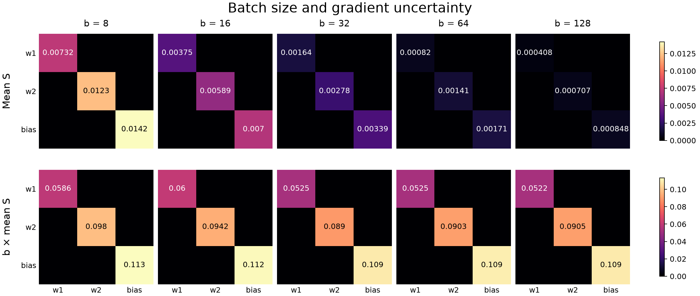

# Batch size and gradient uncertainty

This checks Section 2(c) of the homework: how batch size affects the uncertainty
estimate in Equation (4).

## Setup

One logistic-regression model stays fixed on 1,000 balanced Simulation 1 examples.
For each batch size (8, 16, 32, 64, 128), we sample 200 independent batches with
replacement from that same dataset. There is no training or artificial gradient
noise. Randomness comes from dataset generation and batch sampling.

The dataset seed is 42, model seed is 0, and sampling seed is 1. Each batch gives
an uncertainty matrix S using the homework's diagonal covariance-of-the-mean
estimate, including its shared ridge. The three parameters are w1, w2 and bias.

## Reading the plot



- **Top: mean S.** The full 3-by-3 matrix, averaged over the 200 batches at each size.
- **Bottom: b × mean S.** The same average multiplied by batch size. Similar values
  across this row support approximately 1/b scaling.

Each row has its own shared colour scale. Dark off-diagonal cells are zero:
S is diagonal by construction, not because the gradients are uncorrelated.

## Why the expected scaling is 1/b

This follows from Equation (4) and the variance rule for independent
observations. The PDF asks us to investigate batch size; it does not explicitly
state the 1/b conclusion.

For coordinate j, write the batch mean as $g_j = b^{-1}\sum_{i=1}^b v_{i,j}$.
Before adding the ridge, Equation (4) can be rewritten as

$$
\widehat{s}_j
= \frac{1}{b(b-1)}\sum_{i=1}^{b}(v_{i,j}-g_j)^2
= \frac{1}{b}\left[\frac{1}{b-1}\sum_{i=1}^{b}(v_{i,j}-g_j)^2\right].
$$

The expression in brackets is the usual unbiased sample variance of the
individual gradient observations. Call their population variance $C_{jj}$.
With the model parameters and sampling distribution fixed, $C_{jj}$ does not
change with batch size. Therefore,

$$
\mathbb{E}[\widehat{s}_j] = \frac{C_{jj}}{b}.
$$

Equivalently, independence gives the variance of the mean gradient:

$$
\operatorname{Var}(g_j)
= \frac{1}{b^2}\sum_{i=1}^{b}\operatorname{Var}(v_{i,j})
= \frac{C_{jj}}{b}.
$$

Sampling with replacement makes the draws independent, conditional on our
fixed dataset, so this relationship also applies to this experiment.
Doubling batch size halves the expected variance estimate, while individual
batches fluctuate. Multiplying the estimates by b should consequently give
roughly constant averages, which motivates the plot's second row.

The final matrix uses $s_j = \widehat{s}_j + \varepsilon$. Its scaling is
approximate, especially if the ridge floor matters. Also, variance scales as
1/b; the corresponding standard deviation scales as $1/\sqrt{b}$.

## Main conclusions

Larger batches reduce estimated uncertainty in all three parameter directions:

| Batch size | Mean S: w1 | Mean S: w2 | Mean S: bias |
| --- | --- | --- | --- |
| 8 | 0.00732 | 0.01225 | 0.01416 |
| 16 | 0.00375 | 0.00589 | 0.00700 |
| 32 | 0.00164 | 0.00278 | 0.00339 |
| 64 | 0.000820 | 0.001412 | 0.001710 |
| 128 | 0.000408 | 0.000707 | 0.000848 |

The reduction is approximately proportional to 1/b. For example, multiplying
the bias uncertainty by batch size gives 0.113, 0.112, 0.109, 0.109 and 0.109.
This agrees with the covariance-of-the-mean relationship: before adding the
ridge, the expected diagonal estimate is the individual gradient variance
divided by batch size. The small ridge preserves positive diagonal entries.

The parameter directions have different uncertainty levels. Here bias has the
largest estimate and w1 the smallest; that ordering is specific to this model
and dataset.

The experiment checks the uncertainty estimator, not training performance.
It does not establish which batch size or optimizer gives better accuracy.
Larger batches use more sampled observations per estimate. The 200 repetitions
measure batch-sampling variability at one fixed model and dataset; they do not
measure variability across datasets or training seeds. Per-direction standard
deviations and standard errors are recorded in the JSON summary.

## Reproduce

From the repository root:

```sh
python -m experiments.run_batch_size_exp
```

The script saves the [PNG](batch_size_outputs/uncertainty_heatmaps.png),
[PDF](batch_size_outputs/uncertainty_heatmaps.pdf),
[settings and summary](batch_size_outputs/summary.json), and
[all sampled diagonals and ridges](batch_size_outputs/matrices.csv).
Together the diagonal entries and zero off-diagonal entries specify every S.
